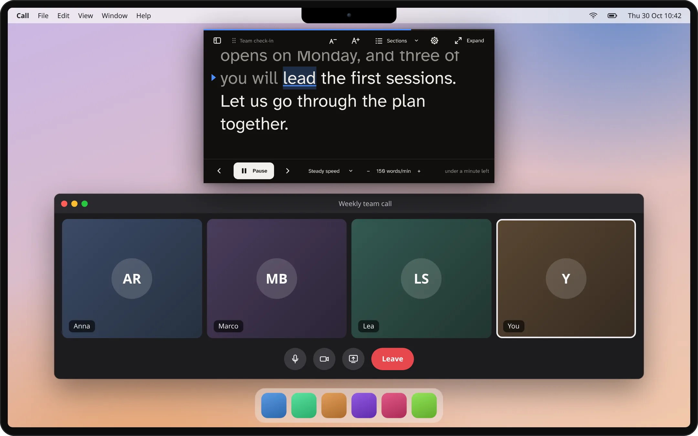

# Kalipso

**A free desktop teleprompter with source available for Linux, Windows and macOS.** Write or import a script,
keep the reader next to your webcam, and advance with your voice, at a steady pace, or with a key,
pedal or phone. Speech recognition runs on your computer.

[Download](https://github.com/SANSEVIERIA-OU/kalipso/releases/latest) ·
[Website and browser demo](https://sansevieria-ou.github.io/kalipso/) ·
[User guide](docs/standalone.md) · [Installation](docs/install.md) ·
[Comparison with other teleprompters](docs/comparison.md)



*The reader is a real Kalipso capture; the surrounding desktop and video call are illustrations.*

## Write, rehearse, present

Kalipso uses one window for writing and reading. Expand it to edit your script with bold, italic,
section headings and direction cues. Start reading or place the window under the camera to keep the
controls out of the way. Pause and expand it to edit again. The library saves scripts and reading
positions locally.

| Reading mode | How it works |
| --- | --- |
| Voice | Matches recognized speech to the script and highlights your place. It can recover after skips and off-script passages; accuracy depends on the language, model, microphone and delivery. |
| Steady | Advances at a chosen words-per-minute pace, with an optional countdown. |
| Manual | Advances with keyboard shortcuts, a keyboard-emulating pedal or clicker, or the local phone remote. |

Manual and steady modes need neither a microphone nor a speech model. Voice commands such as
“restart” are deliberately excluded: saying a command as part of a script must not move the reader.

## What you can do

- **Keep your notes near the camera.** Use a compact, frameless reader above other windows, choose a
  monitor, or expand it for writing. Window placement follows the capabilities of your desktop.
- **Bring existing material.** Import `.txt`, `.md`, Word `.docx`, Writer `.odt`, and the speaker notes
  in PowerPoint `.pptx` or Impress `.odp`. Use `[smile]` cues and `# Section` headings without having
  them treated as spoken words.
- **Follow an Impress presentation.** Move through a LibreOffice Impress slideshow and Kalipso moves
  to the current slide's notes. Available on Linux, Windows and macOS; PowerPoint supports notes
  import, not live slideshow following.
- **Read comfortably.** Adjust font, text size, line spacing and colors; use horizontal, vertical or
  combined mirroring for teleprompter glass. Interface text can grow to 200% independently of the script.
- **Control the reader.** Customize keyboard bindings, use compatible HID pedals/clickers, or pair a
  phone browser through a QR code on the same local network. The phone remote is experimental and
  should be rehearsed before a live presentation.
- **Review a rehearsal.** Voice-session reports include pace, longer pauses and time per section.
  Reports are local; Kalipso does not record a video or produce subtitles.

See [writing scripts and supported import formats](docs/scripts.md) and the
[reader, controls and screen-sharing guide](docs/standalone.md).

## Choose your app

| Edition | Platform | What it provides |
| --- | --- | --- |
| Standalone app | Linux; Windows x64; Apple Silicon macOS | The editor, script library, document import, movable reader, Impress following and phone remote. |
| Plasma widget | KDE Plasma 6 | A reader on the desktop or panel, with manual, steady and local voice modes. |
| GNOME extension | GNOME Shell 48 and 51 | A reader beneath the top bar, with manual, steady and local voice modes. |
| Website demo | Modern desktop and mobile browsers | A short interactive demonstration. It is not an offline PWA or the full app; edits reset when reloaded. |

The widget and extension can use the local speech companion without running the standalone app.
See [Plasma and GNOME installation and behavior](desktop/README.md).

## Install

Get packages from the [latest release](https://github.com/SANSEVIERIA-OU/kalipso/releases/latest).
Packages are not yet signed with a trusted publisher certificate or notarized; Windows and macOS
may ask for confirmation. Releases include `SHA256SUMS` and GitHub build provenance attestations.

| System | Package or command |
| --- | --- |
| Arch Linux / EndeavourOS | `yay -S kalipso-bin` for the prebuilt package; `kalipso` builds from source. |
| Debian 13 / Ubuntu 24.04+ | Download the `.deb`, then `sudo apt install ./kalipso_*_amd64.deb`. |
| Fedora | Download the `.rpm`, then `sudo dnf install ./kalipso-*.x86_64.rpm`. |
| Windows 10 1809+ / Windows 11, x64 | Run the `.msi`, or unpack the portable `.zip`. |
| macOS 14.4+, Apple Silicon | Open the `.dmg` and drag Kalipso to Applications. System voice recognition additionally requires macOS 26 and supported hardware/languages. |

Linux packages also contain the companion and desktop integrations. Add the Plasma widget through
**Add Widgets**. On GNOME, log out and back in, then enable **Settings → Appearance → GNOME top bar**
in Kalipso, or use GNOME's Extensions app.

[Full installation, source build, verification, update, rollback and removal instructions](docs/install.md)

## Start your first rehearsal

1. Open Kalipso and write, import or try a sample script. You can also run `kalipso --demo --prompter`;
   demo mode leaves your saved scripts alone and does not start the microphone.
2. Choose **Voice**, **Steady** or **Manual**. For voice following, open **Settings → Voice**, choose the
   language you speak and test the microphone. Kalipso downloads a supported model when you choose it;
   the download size is shown beforehand.
3. Click the word where you want to start, select **Under the camera** if useful, then press **Start**.
   Pause whenever you need to edit. Rehearse with the microphone and meeting/recording app you will use.

## Languages and local speech

The app, website, companion and desktop integrations have **39 interface languages**, including
right-to-left Arabic, Egyptian Arabic and Urdu. Choose **Settings → Appearance → Interface language**
and restart Kalipso. The website's language picker changes the page immediately.

The interface language does **not** select the language of speech recognition:

| System | Voice recognition |
| --- | --- |
| Linux | Downloadable Moonshine models for English, German, Spanish, Japanese and Chinese; Vosk also covers Italian. Compatible models can be configured manually. After installation, recognition works offline. Automatic model downloads target Linux x86-64. |
| Windows x64 | Guided Moonshine and Vosk downloads, including Italian with Vosk. Microsoft desktop SAPI remains optional; Windows OneCore speech packs are not interchangeable with SAPI. |
| macOS | Guided Vosk downloads, including Italian. Moonshine downloads require Apple Silicon and macOS 15+. Apple's system speech remains optional on macOS 26+ with compatible hardware and languages. |

All three systems can also use manually supplied models and matching native libraries. Downloaded
models work offline; choosing a language is the explicit download action.
There is no automatic cloud-recognition fallback. See [Linux speech setup](docs/local-engine.md) and
[Windows/macOS speech requirements](docs/system-speech.md).

Non-English catalogs are generated translations awaiting native-speaker review, including additions
to Italian. [Help review translations](docs/translations.md).

## Privacy and screen sharing

Scripts, settings and reports stay on your computer. Speech is processed locally. Downloading a
model needs an Internet connection; using the phone remote intentionally exposes its protected
control page to your local network. The desktop app does not provide cloud sync or require an account.

Capture exclusion is platform-dependent:

- **Windows 10 2004+ and Windows 11:** Kalipso requests exclusion of the reader from screen captures.
- **KDE Plasma 6.6+:** the KWin integration requests exclusion while the reader is under the camera.
- **macOS, GNOME and other unsupported setups:** share an individual window instead of the whole screen.

A request to exclude a window is not a universal guarantee. Check another participant's view or a
recorded sample with your actual software. [Details and permissions](docs/standalone.md#screen-sharing)

## Current status and boundaries

Linux is the main development platform. Windows and macOS ports remain experimental despite passing
automated builds, app tests and packaging checks. CI also tests Windows installer upgrades/removal and
Impress integration across the three operating systems. These checks do not establish microphone
accuracy, permissions behavior or compatibility with every conferencing app on users' hardware.

Kalipso currently has no built-in video recording, automatic captions/SRT export, cloud collaboration,
native mobile app, dedicated Stream Deck plugin, or separate presenter and mirrored output windows.
The browser demo is not a replacement for those features. Keep a copy of important notes and rehearse
before relying on speech following or the phone remote in a live event.

See the [dated, source-linked competitor comparison and remaining gaps](docs/comparison.md),
[accessibility coverage](docs/accessibility.md) and [performance measurements](docs/performance.md).

## Build and contribute

Kalipso is a C++20/Qt 6 application. Linux also uses PipeWire; desktop integrations are QML and
GNOME Shell JavaScript. CMake, Ninja and Qt LinguistTools are required for a normal source build.

```sh
cmake -S . -B build -G Ninja -DCMAKE_BUILD_TYPE=Release
cmake --build build --parallel 2
ctest --test-dir build --output-on-failure
```

Install platform dependencies first: [Linux/source build](docs/install.md),
[Windows and macOS](docs/system-speech.md). For contributions, tests and release conventions, read
[CONTRIBUTING.md](CONTRIBUTING.md). Report problems with your OS/desktop, Kalipso version and steps to
reproduce in [Issues](https://github.com/SANSEVIERIA-OU/kalipso/issues). Release history lives in
[CHANGELOG.md](CHANGELOG.md).

## License

The current original application, companion, Plasma widget, KWin script and website
use **SANSEVIERIA License 1.0**, with the component exceptions identified below.
It permits free use, modification and compliant forks, with source reciprocity; the commercial
offerings defined in the licence require written authorization from SANSEVIERIA OÜ.
This is a source-available licence, not an OSI-approved open-source licence.

The rights holder may offer earlier versions under this licence too. Any permissions already
validly granted on copies under other terms remain unaffected; a version number alone does not
fix the licence of every copy. The GNOME extension currently retains its separate AGPL terms,
including its own module and translation snapshots. This is not an AGPL alternative for the
application, website, Plasma widget or shared code.
See [LICENSE](LICENSE), the exact [scope and release notice](NOTICE),
[third-party notices](THIRD_PARTY_NOTICES.md), and bundled font licences.
AppStream metadata remains CC0-1.0. Kalipso is independent of KDE and GNOME.
